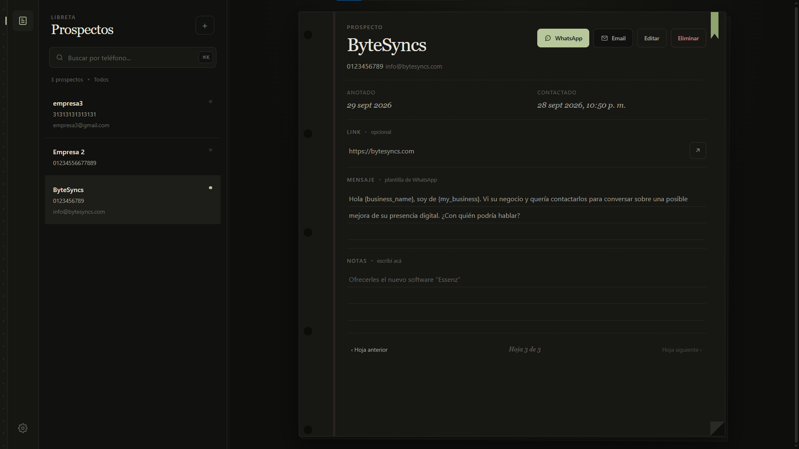
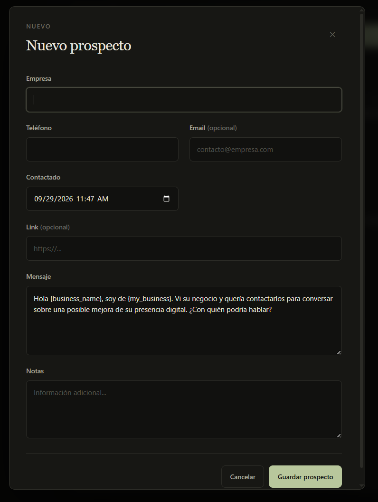

# DirectLead

[🇪🇸 Español](README.es.md) · [🇺🇸 English](README.en.md)

An open-source desktop application to organize leads and prepare contact messages. DirectLead stores records locally on your computer and allows you to open WhatsApp, a mail application, or external links whenever requested.

> **Current version:** 1.0.0 · **Configured distribution platform:** Windows x64

## Preview




## Features

- Create, view, search, edit, and delete leads.
- Save business name, phone number, email, contact date, link, message, and notes.
- Edit select details directly from the lead view or use the full form.
- Prepare messages for WhatsApp and email using templates and variables, such as `{ business_name }` and `{ my_business }`.
- Open WhatsApp Web or WhatsApp Desktop, or draft an email in your default mail app.
- Search leads and actions using the command palette (`Ctrl+K`).
- Customize shortcuts and adjust the list panel width.
- Access Help, DirectLead Privacy Policy, and Terms of Use directly within the app.

DirectLead **does not send messages automatically**. When choosing WhatsApp or Email, it opens the corresponding service pre-filled with the number or content; the user decides whether to proceed and send the message.

## Download and Installation

Published installers can be found under the **Releases → Assets** tab of this repository. For Windows x64, download the `DirectLead-<version>-Setup.exe` file.

1. Download the installer from the release you want to use.
2. Open the `.exe` and follow the installer steps.
3. Launch DirectLead from the Start menu shortcut or desktop icon.

Windows may display an unknown publisher warning if the installer is not signed with a code signing certificate. Only download installers from the official Releases of this repository.

## Getting Started

1. Click `+` on the Leads list or use the customizable shortcut to create a new lead.
2. Fill in Business Name, Phone, Contacted Date, and Message. Email, Link, and Notes are optional.
3. Select a lead to view or edit its details.
4. Go to Settings → Message Settings to define your business name and set up your WhatsApp or email templates.
5. To contact a lead, select it and click WhatsApp or Email.

Templates accept the following variables:

| Variable | Replaced by |
| --- | --- |
| `{ business_name }` | The lead's business name |
| `{ phone }` | Saved phone number |
| `{ email }` | Saved email address |
| `{ url }` | Saved link |
| `{ my_business }` | Your business name configured in DirectLead |

## Shortcuts

Shortcuts can be viewed and modified in **Settings → Shortcuts**. Default values:

| Action | Default shortcut |
| --- | --- |
| New lead | `N` |
| Quick search | `Ctrl+K` (`Cmd+K` on macOS, though no macOS installer is configured) |
| Close dialog or go back | `Esc` |
| Previous/next result in command palette | `↑` / `↓` |
| Open selected result | `Enter` |
| Collapse/expand list when separator is focused | `←` / `→` |

Keybindings are saved locally. The Shortcuts section allows restoring default values at any time.

## Data and Privacy

- Leads are saved locally in an SQLite database, `directlead.db`, located inside Electron's user data directory.
- Message preferences, shortcuts, and list width settings are stored in local application profile storage.
- The current version does not require an account nor does it sync leads to the cloud.
- DirectLead does not track analytics or telemetries in the current codebase.
- When opening WhatsApp, email, or external links, necessary data is passed to the selected external service. That service's respective policies apply.
- Uninstalling the app may not automatically delete local data. Please maintain your own backups and secure your machine.

Specific legal documents can be found at [`docs/legal/privacy.md`](docs/legal/privacy.md) and [`docs/legal/terms.md`](docs/legal/terms.md). These are **drafts pending legal review** and do not constitute legal advice or finalized public documents.

If remote storage or cloud synchronization is added in the future, the app and its documentation will be updated to outline data handling prior to transmission and require explicit user consent.

## Tech Stack

- Electron 44
- TypeScript for main process and preload script
- JavaScript, HTML, and Tailwind CSS 4 for the renderer
- SQLite via `better-sqlite3`
- `marked` for rendering Markdown legal documents in-app
- electron-builder for building the Windows installer

## Development

### Prerequisites

- Windows x64 for the documented build/packaging commands.
- Node.js compatible with project dependencies.
- pnpm 12.6.0 (declared in `packageManager`).
- Visual Studio Build Tools 2022 with **Desktop development with C++** workload, MSVC v143, and Windows SDK to compile `better-sqlite3` for Electron.

### Install Dependencies and Run

```powershell
pnpm install
pnpm dev

```

`pnpm dev` builds the app and launches watchers for TypeScript, Tailwind, and renderer alongside Electron.

### Useful Commands

| Command | Description |
| --- | --- |
| `pnpm build` | Compiles TypeScript, builds production CSS, and copies renderer and legal docs to `dist/`. |
| `pnpm start` | Launches the compiled application with Electron. |
| `pnpm dev` | Starts the development workflow with live watchers. |
| `pnpm package:win` | Generates a Windows x64 NSIS installer inside `release/`. |
| `pnpm package:win:dir` | Generates the unpacked Windows x64 application directory for inspection. |

The configured installer file is named `DirectLead-<version>-Setup.exe`. To publish on GitHub, create a Release and attach this `.exe` as an asset; uploading the `win-unpacked` folder is not required.

The database is initialized on app startup. Migrations are located in `src/database/migrations.ts`.

## Project Structure

```text
src/
  main.ts                 Electron main process and window creation
  preload.cts             Bridge API between renderer and main process
  database/               SQLite connection, migrations, and repository
  ipc/                    IPC handlers for leads and WhatsApp integration
  renderer/               UI logic, controllers, and Tailwind styles
  services/               Application services
  types/                  Shared TypeScript types and window API definitions
docs/legal/               Draft legal documents (privacy and terms)
scripts/                  Build scripts for copying assets to the dist directory

```

## Open Source & License

DirectLead is released under the **ISC** license. See [`LICENSE`](LICENSE) for details. Third-party dependencies maintain their respective licenses.

## Contact

ByteSyncs: [bytesyncs.com](https://bytesyncs.com) · [info@bytesyncs.com](mailto:info@bytesyncs.com)

