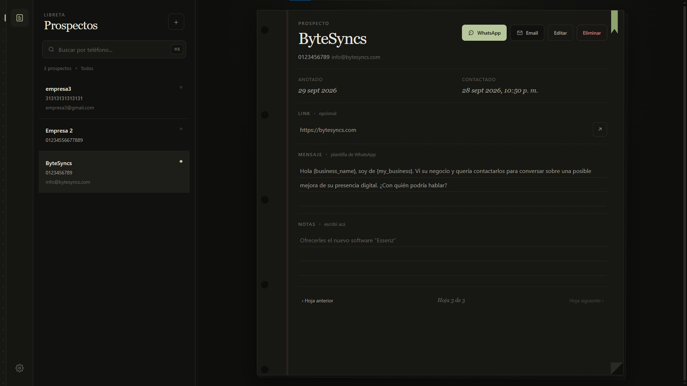
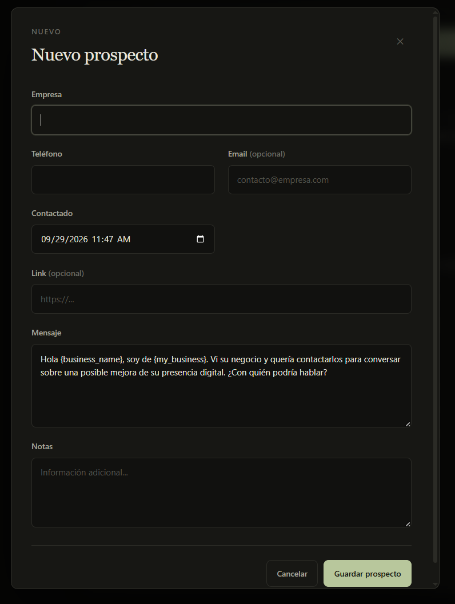

# DirectLead

[🇪🇸 Español](README.es.md) · [🇺🇸 English](README.en.md)

Aplicación de escritorio open source para organizar prospectos y preparar mensajes de contacto. DirectLead guarda los registros en el equipo y permite abrir WhatsApp, una aplicación de correo o enlaces externos cuando la persona usuaria lo solicita.

> **Versión actual:** 1.0.0 · **Plataforma de distribución configurada:** Windows x64

## Vista previa





## Funciones

- Crear, consultar, buscar, editar y eliminar prospectos.
- Guardar nombre del negocio, teléfono, email, fecha de contacto, link, mensaje y notas.
- Editar algunos datos directamente desde la ficha del prospecto o usar el formulario completo.
- Preparar mensajes para WhatsApp y email mediante plantillas y variables, como `{ business_name }` y `{ my_business }`.
- Abrir WhatsApp Web o WhatsApp Desktop, o preparar un email en la aplicación predeterminada.
- Buscar prospectos y acciones desde la paleta de comandos (`Ctrl+K`).
- Personalizar atajos y ajustar el ancho del panel de la lista.
- Consultar Ayuda, Privacidad de DirectLead y Términos de uso desde la aplicación.

DirectLead **no envía mensajes automáticamente**. Al elegir WhatsApp o Email, abre el servicio correspondiente con el número o contenido preparado; la persona usuaria decide si continúa y envía el mensaje.

## Descargar e instalar

Los instaladores publicados se encuentran en la pestaña **Releases → Assets** de este repositorio. Para Windows x64, descarga el archivo `DirectLead-<versión>-Setup.exe`.

1. Descarga el instalador desde el release que quieras usar.
2. Abre el `.exe` y sigue los pasos del instalador.
3. Inicia DirectLead desde el acceso directo del menú Inicio o del escritorio.

Windows puede mostrar una advertencia de editor desconocido mientras el instalador no esté firmado con un certificado de firma de código. Descarga instaladores únicamente desde los Releases oficiales de este repositorio.

## Primeros pasos

1. Pulsa `+` en la lista de Prospectos o usa el atajo configurable para crear uno.
2. Completa Empresa, Teléfono, Contactado y Mensaje. Email, Link y Notas son opcionales.
3. Selecciona el prospecto para consultar o editar su ficha.
4. En Configuración → Configuración de Mensajes, define el nombre de tu negocio y tus plantillas de WhatsApp o email.
5. Para abrir un contacto, selecciona el prospecto y pulsa WhatsApp o Email.

Las plantillas aceptan estas variables:

| Variable | Se reemplaza por |
| --- | --- |
| `{ business_name }` | Nombre del negocio del prospecto |
| `{ phone }` | Teléfono guardado |
| `{ email }` | Email guardado |
| `{ url }` | Link guardado |
| `{ my_business }` | El nombre de tu negocio configurado en DirectLead |

## Atajos

Los atajos se pueden consultar y cambiar en **Configuración → Atajos**. Valores iniciales:

| Acción | Atajo inicial |
| --- | --- |
| Nuevo prospecto | `N` |
| Búsqueda rápida | `Ctrl+K` (`Cmd+K` en macOS, aunque no hay instalador de macOS configurado) |
| Cerrar diálogo o volver | `Esc` |
| Resultado anterior/siguiente en la paleta | `↑` / `↓` |
| Abrir resultado seleccionado | `Enter` |
| Reducir/ampliar la lista cuando el separador está enfocado | `←` / `→` |

Las asignaciones se guardan localmente. La sección Atajos permite restaurar los valores predeterminados.

## Datos y privacidad

- Los prospectos se guardan en una base SQLite local, `directlead.db`, dentro del directorio de datos de usuario de Electron.
- Las preferencias de mensajes, los atajos y el ancho de la lista se guardan en el almacenamiento local del perfil de la aplicación.
- La versión actual no requiere cuenta ni sincroniza prospectos con la nube.
- DirectLead no implementa analítica ni telemetría en el código actual.
- Al abrir WhatsApp, email o un link, los datos necesarios se entregan al servicio externo elegido. Se aplican las políticas de dicho servicio.
- Desinstalar la aplicación puede no borrar los datos locales. Haz tus propias copias de seguridad y protege el acceso al equipo.

Los documentos de privacidad y términos de uso propios de DirectLead están en [`docs/legal/privacy.md`](docs/legal/privacy.md) y [`docs/legal/terms.md`](docs/legal/terms.md). Al primer inicio, la aplicación solicita aceptar los Términos para continuar. La aceptación se guarda localmente por versión.

Si en el futuro se añade almacenamiento remoto o sincronización, se deberá actualizar la app y su documentación para explicar el tratamiento antes de transmitir datos y solicitar aceptación expresa al usuario.

## Tecnología

- Electron 44
- TypeScript para el proceso principal y preload
- JavaScript, HTML y Tailwind CSS 4 para el renderer
- SQLite mediante `better-sqlite3`
- `marked` para mostrar los documentos legales Markdown dentro de la app
- electron-builder para crear el instalador de Windows

## Desarrollo

### Requisitos

- Windows x64 para los comandos de empaquetado documentados.
- Node.js compatible con las dependencias del proyecto.
- pnpm 12.6.0 (declarado en `packageManager`).
- Visual Studio Build Tools 2022 con la carga **Desarrollo para el escritorio con C++**, MSVC v143 y Windows SDK para compilar `better-sqlite3` para Electron.

### Instalar dependencias y ejecutar

```powershell
pnpm install
pnpm dev
```

`pnpm dev` construye la app y ejecuta los watchers de TypeScript, Tailwind y renderer junto con Electron.

### Comandos útiles

| Comando | Descripción |
| --- | --- |
| `pnpm build` | Compila TypeScript, genera CSS de producción y copia renderer y documentos legales a `dist/`. |
| `pnpm start` | Abre la aplicación compilada con Electron. |
| `pnpm dev` | Inicia el flujo de desarrollo con watchers. |
| `pnpm package:win` | Genera un instalador NSIS de Windows x64 en `release/`. |
| `pnpm package:win:dir` | Genera la aplicación desempaquetada de Windows x64 para inspección. |

El instalador configurado se llama `DirectLead-<versión>-Setup.exe`. Para subirlo a GitHub, crea un Release y adjunta ese `.exe` como asset; no hace falta subir la carpeta `win-unpacked`.

La base de datos se crea al iniciar la aplicación. Las migraciones se encuentran en `src/database/migrations.ts`.

## Estructura del proyecto

```text
src/
  main.ts                 Proceso principal de Electron y ventana
  preload.cts             API controlada entre renderer y proceso principal
  database/               Conexión, migraciones y repositorio SQLite
  ipc/                    Canales IPC de prospectos y WhatsApp
  renderer/               Interfaz, controlador y estilos Tailwind
  services/               Servicios de aplicación
  types/                  Tipos compartidos y API de ventana
  docs/legal/               Política de privacidad y términos de uso de DirectLead
scripts/                  Copia de recursos al directorio dist
```

## Open source y licencia

DirectLead se distribuye bajo la licencia **ISC**. Consulta [`LICENSE`](LICENSE) para ver sus términos. Las dependencias de terceros conservan sus propias licencias.

## Contacto

ByteSyncs: [bytesyncs.com](https://bytesyncs.com) · [info@bytesyncs.com](mailto:info@bytesyncs.com)
