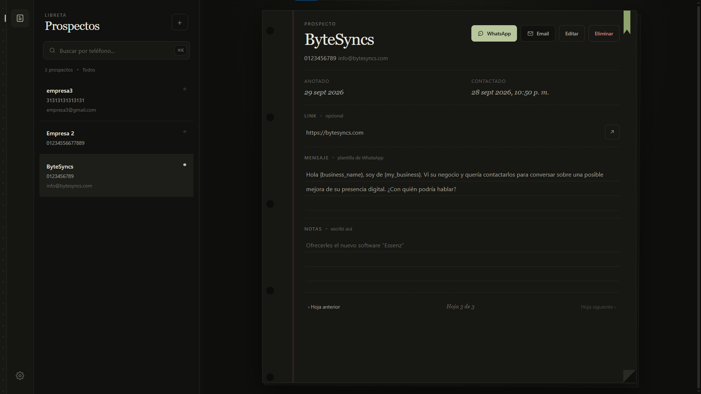
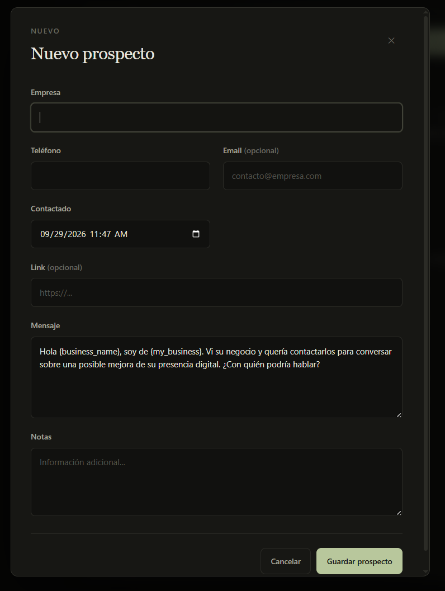
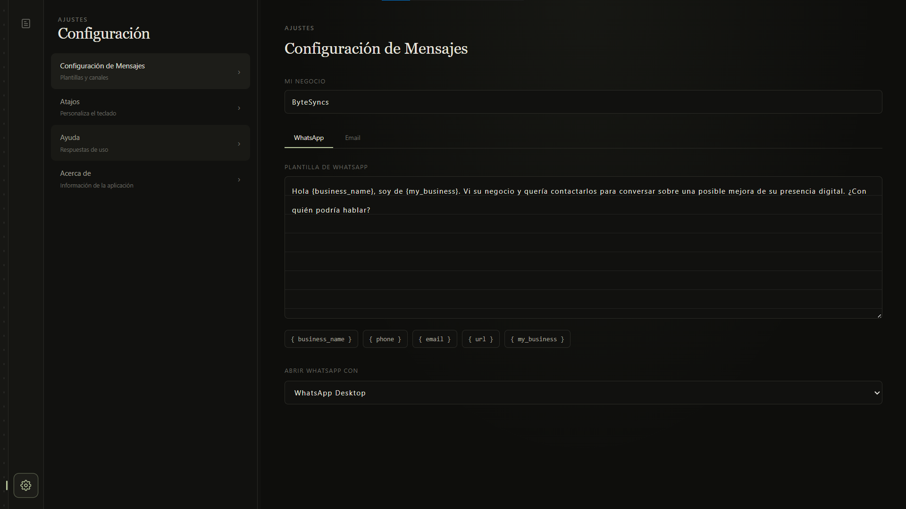

# DirectLead

<strong>Organiza prospectos. Prepara contactos. Mantén todo en tu equipo.</strong>

  <a href="README.es.md">🇪🇸 Español</a>
  &nbsp;·&nbsp;
  <a href="README.en.md">🇺🇸 English</a>

DirectLead es una aplicación de escritorio open source para organizar prospectos y preparar mensajes de contacto. Los registros se guardan localmente y la app abre WhatsApp, email o enlaces externos solo cuando la persona usuaria lo solicita.

## Capturas

## Descargar

Abre la pestaña **Releases** de este repositorio y descarga el instalador correspondiente desde **Assets**. Para Windows x64, el archivo tiene el formato `DirectLead-<versión>-Setup.exe`.

## Licencia

DirectLead se distribuye bajo la licencia [ISC](LICENSE). Consulta la documentación en el idioma que prefieras usando las banderas de arriba.